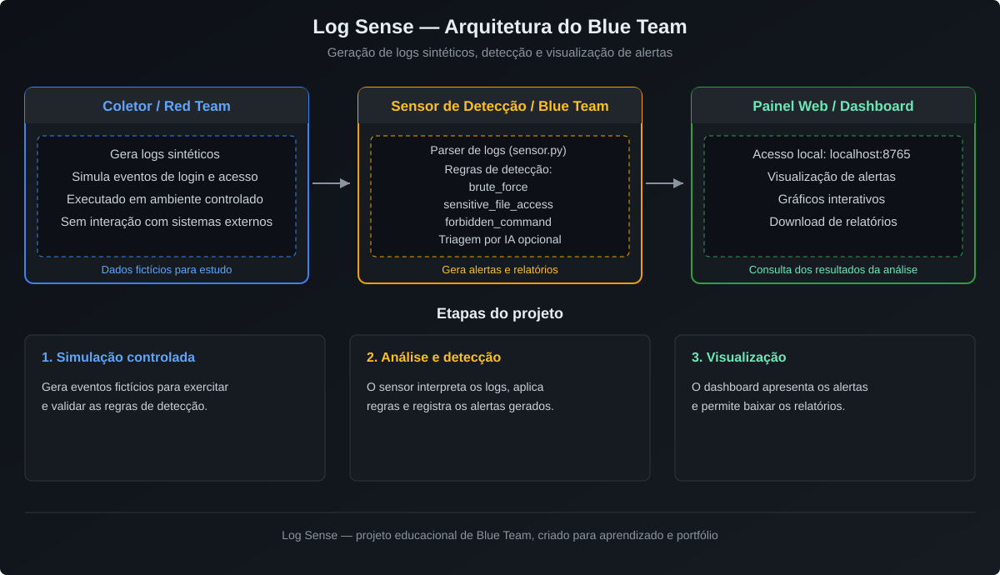

# 🔒 log-sense — Blue Team Security Lab

**Ferramenta de detecção e análise de segurança para estudantes e profissionais** que querem aprender como funciona um SOC real — simulação de ataque (Red) e detecção (Blue) em um único repositório.

[](https://github.com/flptr/log-sense/actions)
[](https://www.python.org/downloads/)
[](LICENSE)

---

## O que é?

O **log-sense** é um laboratório de segurança que mostra o fluxo completo de um SOC (Security Operations Center):

```text
[Ambito de teste] → [Sensor de detecção] → [Painel + Relatório]
      (Red Team)        (Blue Team)          (Dashboard + SOC)
```



- **Red Team**: simula ataques fictícios em ambientes controlados (apenas dados sintéticos).
- **Blue Team**: detecta anomalias através de regras de assinatura e gera relatórios de incidentes.
- **Dashboard**: interface web interativa para visualizar alertas e download de relatórios.

### 📥 Formato do log aceito

O sensor lê linhas no formato canônico:

```text
YYYY-MM-DD HH:MM:SS LEVEL EVENT user=... ip=[file=...] [result=...]
```

| Campo | O que é | Exemplo |
|---|---|---|
| `timestamp` | data e hora `AAAA-MM-DD HH:MM:SS`. Para agrupar por minuto, o sensor usa os 15 primeiros caracteres (`AAAA-MM-DD HH:MM`). | `2026-11-11 08:05:00` |
| `LEVEL` | `INFO`, `WARN`, `ERROR` ou `DEBUG` | `WARN` |
| `EVENT` | `login`, `logout`, `access`, `connect`, `file`, `cron`, `ssh`, `dump`, `exec` | `login` |
| `user=` | identidade do usuário (opcional) | `adm` |
| `ip=` | origem do tráfego (opcional) | `10.0.0.5` |
| `file=` | arquivo acessado (opcional) | `/etc/shadow` |
| `result=` | `success`, `failed` ou `denied` (opcional) | `failed` |

> Linhas vazias são ignoradas. Campos não encontrados ficam como `None` no resultado do parser. A regra `brute_force` ignora eventos sem `timestamp`, `user` ou `ip`; as demais regras têm seus próprios campos necessários.

O repositório inclui `scripts/convert.py` para normalizar logs reais de nginx, auth, JSON e CSV para o canônico, antes da análise:

```bash
python scripts/convert.py --input acesso.log --format nginx > canon.txt
python scripts/sensor.py --logs canon.txt
```

> A conversão é uma etapa separada: `scripts/convert.py` normaliza os formatos suportados para o formato canônico, que então é analisado pelo sensor.

> ✅ **Ético**: tudo acontece em ambientes próprios, com logs sintetizados. Nada é atacado de verdade.

---

## Recursos

### ✨ Detecção de anomalias
- **Parser** de logs — extrai timestamp, usuário, IP, arquivo, resultado.
- **Regras de assinatura**: brute force, acesso a arquivos críticos, comandos proibidos.
- **Triagem assistida por IA** (opcional) — um LLM explica cada alerta em linguagem simples.
- **Mapa MITRE ATT&CK** embutido nos alertas.

### 📊 Painel Web interativo
- Painel dark-themed com estatísticas em tempo real.
- Botão de "Rodar detecção" e visualização de alertas.
- Download de relatórios gerados.

### 📦 Containerização
- **Dockerfile** para rodar em qualquer máquina com Docker.
- Porta `8765` exposta, ready-to-run.

### 🧪 Testes automatizados
- `pytest` cobre o parser, as regras de detecção e os conversores.
- CI via GitHub Actions (Windows + Linux).

---

## Como rodar

### Opção 1 — Python (desenvolvimento)
```bash
# 1. Clonar
git clone <repo> && cd log-sense
pip install -r requirements.txt

# 2. Rodar o dashboard
python dashboard.py
# → abra http://localhost:8765

> ⚠️ **Segurança do dashboard:** a interface web **não tem autenticação** e, por
> padrão, escuta em **0.0.0.0** (todas as interfaces da máquina). Não exporte a
> porta em ambientes com outros dispositivos na rede — use `LOG_SENSE_HOST=127.0.0.1`
> para apenas localhost, ou coloque trás de balcão um proxy/com usuário para
> proteger o acesso.
```

### Opção 2 — Docker
```bash
docker build -t log-sense .
docker run -p 8765:8765 log-sense
# → http://localhost:8765
```

### Opção 3 — Executável (Windows)
```bash
pip install pyinstaller
pyinstaller --onefile --name log-sense collector.py
# dist\log-sense.exe
```

### Rodar os testes

```bash
pip install pytest
python -m pytest
```

Executa os testes do parser, das regras de detecção e dos conversores.

---

## Estrutura do repositório

```
log-sense/
├── dashboard.py              # Servidor web + API
├── dashboard.html            # Interface do painel
├── collector.py              # Colector de logs (modo standalone)
├── scripts/
│   ├── sensor.py             # Engine de detecção (parser + regras)
│   ├── convert.py            # Conversores de formatos reais
│   └── ai_explain.py         # IA assistente de triagem
├── tests/                    # Testes automatizados (pytest)
├── Dockerfile                # Containerização
├── requirements.txt
├── CONTRIBUTING.md
├── LICENSE
└── README.md
```

---

## Como funciona a detecção

1. **Coletor** gera logs sintéticos (ou você importa logs reais).
2. **Conversor** normaliza os logs para o formato canônico (via `scripts/convert.py`).
3. **Sensor** aplica regras de assinatura e gera alertas.
4. **Dashboard** exibe os alertas e gera relatórios de incidente.

### Regras de detecção

Cada regra é independente e gera um alerta quando o cenário está presente. Os **limites** indicam o que a regra **não** cobre — essenciais para interpretar os resultados.

| Regra | Severidade | Detecta | Limites / O que não detecta |
|---|---|---|---|
| `brute_force` | high | ≥5 falhas de login para a **mesma** identidade (usuario + IP) no mesmo minuto | Exige `timestamp`, `user` e `IP`. Múltiplos usuários/IPs no mesmo minuto não são somados. |
| `ip_fingerprint_breach` | medium | Login falho com IPs diferentes num mesmo minuto | Agrupa por timestamp **exato**; só aciona se dois IPs distintos aparecem no mesmo segundo. |
| `sensitive_file_access` | high | Acesso a arquivos críticos (`/etc/shadow`, `passwd`, `sudoers`, `authorized_keys`) | Apenas arquivos listados; o `file` deve casar exatamente. |
| `forbidden_command` | critical | Comandos proibidos (`rm -rf /`, `mkfs`, `chmod 777 /`) | Comparação exata do campo `result`. |
| `sqli_query` | high | Padrões suspeitos de SQL em acessos falhados/denied (`union select`, `or 1=1`, `information_schema`, `sleep`, etc.) | Padrões regex; só `access` com `result` em `failed`/`denied`. |
| `xss_reflected` | medium | Padrões de XSS refletido (`<script>`, `javascript:`, `onerror=`, `onload=`, `<svg`) | Padrões regex; só `access` com `result` em `failed`/`denied`. |
| `unauthorized_access` | high | Muitos acessos não autorizados (401/403) no mesmo minuto | Pode somar múltiplos usuários/IPs no minuto. |
| `idle_session` | medium/high | Sessão inativa >30 min após login bem-sucedido | Só considera eventos após um `login` sucesso. |
| `user_enumeration` | medium | Login falho para vários usuários diferentes no mesmo minuto | Agrupa por minuto; requer ≥5 usuários diferentes. |

> ⚠️ **Falso positivo / falso negativo.** Nenhuma regra aqui é garantia de detecção. Regras baseadas em padrões (SQL, XSS, comando) detectam strings típicas de exploração, mas também acertam testes ou mensagens de erro legítimas. Thresholds fixos geram **falso positivo** com atividade legítima intensa e **falso negativo** quando o ataque não bate no padrão definido. Em cenários reais, valide sempre antes de agir.

### Exemplo de entrada → saída

**Entrada** (fragmento de `samples/log.txt`):
```text
2026-11-11 08:05:00 WARN login user=adm ip=198.51.100.10 result=failed
2026-11-11 08:05:01 WARN login user=adm ip=198.51.100.10 result=failed
2026-11-11 08:05:02 WARN login user=adm ip=198.51.100.10 result=failed
2026-11-11 08:05:03 WARN login user=adm ip=198.51.100.10 result=failed
2026-11-11 08:05:04 WARN login user=adm ip=198.51.100.10 result=failed
```

**Saída** (no `alerts/`):
```text
[HIGH] brute_force: 5 tentativas de login falhas no minuto 2026-11-11 08:05 de adm (IP 198.51.100.10)
```

> O contador `5` reflete o limiar da regra. Em `samples/log.txt` completo o contador varia conforme a quantidade de falhas da mesma identidade no mesmo minuto.

---

## Como contribuir

1. Fork o repositório
2. Crie uma branch: `git checkout -b feature/nova-regra`
3. Faça commit: `git commit -m 'feat: adiciona regra de brute force'`
4. Envie: `git push origin feature/nova-regra`

Veja [CONTRIBUTING.md](CONTRIBUTING.md) para detalhes.

---

## Segurança e ética

Este projeto é **apenas para uso educacional e em ambientes controlados**. Nada aqui
ataca sistemas reais. Todos os logs são sintetizados. O **Log Sense não substitui um
SIEM, não está validado para produção e não deve ser considerado uma solução de
detecção reforçada**.

> ⚠️ Acesse sistemas de terceiros apenas em ambientes que você controla. Não teste em
> redes ou servidores de produção, e respeite as políticas de segurança de cada organização.

Recomendamos:
- Usar apenas em máquinas que você controla.
- Não testar em redes ou servidores de produção.
- Respeitar leis e políticas de segurança de cada organização.

> ⚠️ **Dashboard:** a interface web **não tem autenticação**. Por padrão ela escuta
> em `0.0.0.0` (todas as interfaces). Se for expor a porta em rede, use
> `LOG_SENSE_HOST=127.0.0.1` para restringir a localhost ou adicione seu próprio
> proxy/firewall para controlar o acesso. O projeto é educacional e **não deve ser
> usado como painel de segurança de produção**.

## Licença

MIT — veja o arquivo [LICENSE](LICENSE).

---

> Feito com ❤️ para estudantes e profissionais que querem aprender segurança da informação sem perder a ética.
## Notas para o portfólio

> **Ético:** só processa logs fictícios. A opção de triagem com IA, se ativada, envia os dados para um endpoint de API **configurável por você** via variável de ambiente `--ai-endpoint`. Nada vai para servidores externos por padrão — você deve definir explicitamente onde os dados serão enviados.
- **Reprodutível:** `samples/log.txt` é o input; o alerta gerado é o output.
- **MITRE ATT&CK (mapa conceitual desses cenários):**
  - `T1110` Brute Force (regra `brute_force`)
  - `T1003` Credential Access / `T1070` Data Obfuscation (regra `sensitive_file_access`)
  - `T1059` Command and Scripting Interpreter (regra `forbidden_command`)
  - `T1021` Remote Services / `T1078` Valid Accounts (regra `ip_fingerprint_breach`)
- **Cenários de estudo:** brute force, exfiltração de arquivos system, acesso cruzado
  de IP (pode indicar redirecionamento ou credencial compartilhada).

---

*log-sense é um projeto didático. Para ambientes reais, use SIEMs e regras validadas que
obedeçam à política de segurança e à legislação aplicável.*
